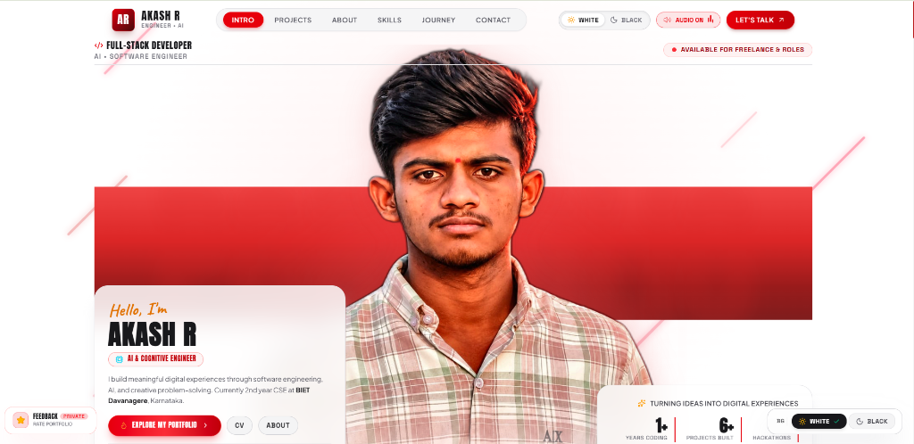

<div align="center">

# ⚡ AKASH R — DEVELOPER PORTFOLIO

**Full-Stack Developer &bull; AI & Cognitive Engineer &bull; CSE @ BIET Davanagere**

[](https://react.dev/)
[](https://www.typescriptlang.org/)
[](https://vitejs.dev/)
[](https://tailwindcss.com/)
[](https://www.framer.com/motion/)

<br />

<!-- Hero Preview Banner -->


<br /><br />

[Explore Portfolio](#-features) &bull; [Tech Stack](#%EF%B8%8F-tech-stack) &bull; [Quick Start](#-getting-started) &bull; [Feedback Vault](#-private-feedback--owner-vault) &bull; [Connect](#-connect-with-me)

</div>

---

## 👨‍💻 About Akash

I am a Computer Science and Engineering student at **Bapuji Institute of Engineering and Technology (BIET), Davanagere**, specializing in full-stack web applications and AI-driven systems. This portfolio is engineered as a high-impact, cinematic digital showcase highlighting interactive experiences, technical depth, and clean design.

---

## ✨ Features

- 🎬 **Cinematic Presentation**: 2.39:1 aspect ratio letterboxing, bold typography, dynamic diagonal streaks, and high-framerate transitions.
- 🌗 **Dual Theme Engine (White / Black)**: Dedicated floating selector with instantaneous theme transitions and tailored contrast balancing.
- 🎵 **Web Audio Ambient Synthesizer**: Custom synthesized click ticks, chime chords, and ambient audio with a quick mute toggle.
- 💼 **Interactive Project Showcase**: Deep-dive modals for full-stack and AI projects featuring real-time architecture, tags, and source links.
- 🏆 **Hackathons & Verified Certifications**:
  - **Hackering 2.0 (36-Hour National Hackathon)** at RVITM, Bengaluru (Team HACK CORE).
  - **HackerRank Certified**: Python (Basic), Problem Solving (Basic), and C# (Basic).
  - Direct external verification links for credentials and certificate PDFs.
- 🔒 **Private Feedback Form & Secret Owner Vault**:
  - Visitors can submit ratings (1–5 stars), reviewer roles, feedback categories, and comments.
  - Submissions are delivered privately to `akashakashr505@gmail.com`.
  - Portfolio owner can access an on-site, PIN-protected admin vault (`Ctrl + Shift + F`) to read reviews, filter by rating, and export to CSV.

---

## 🛠️ Tech Stack

| Category | Technologies |
| :--- | :--- |
| **Framework & Core** | React 19, TypeScript, Vite |
| **Styling & Design** | Tailwind CSS v4, Custom CSS Variables |
| **Motion & FX** | Framer Motion, Canvas Confetti |
| **Audio** | HTML5 Web Audio API Synthesizer |
| **Icons** | Lucide React |
| **Forms & Delivery** | FormSubmit AJAX API & Local Storage Vault |

---

## 📂 Project Structure

```text
portfolio/
├── public/
│   ├── images/              # Cutouts, project logos & graphics
│   ├── preview.png          # Portfolio hero preview banner
│   └── favicon.svg          # Portfolio monogram favicon
├── src/
│   ├── components/
│   │   ├── HeroSection.tsx          # Cinematic opening section
│   │   ├── ProjectShowcase.tsx      # Interactive project cards
│   │   ├── ProjectModal.tsx         # Detailed project dialog
│   │   ├── AboutSection.tsx         # Bio, background & education
│   │   ├── SkillsSection.tsx        # Filterable skills repertoire
│   │   ├── AcademicsSection.tsx     # Dedicated academics & BIET coursework
│   │   ├── HackathonsSection.tsx    # Hackathons & Hackering 2.0 sprint
│   │   ├── CertificationsSection.tsx# Verified HackerRank certifications
│   │   ├── ContactSection.tsx       # Direct message form & socials
│   │   ├── FeedbackModal.tsx        # Floating visitor feedback form
│   │   ├── FeedbackAdminModal.tsx   # PIN-protected owner admin viewer
│   │   ├── Navbar.tsx               # Header navigation & audio controls
│   │   └── ThemeToggle.tsx          # Floating & navbar theme switches
│   ├── context/
│   │   └── ThemeContext.tsx         # Theme provider & persistence
│   ├── types/
│   │   └── feedback.ts              # TypeScript interfaces for feedback
│   ├── utils/
│   │   ├── audio.ts                 # Web Audio synthesizer controller
│   │   └── feedbackStorage.ts       # Storage & PIN vault utilities
│   ├── App.tsx                      # Root layout & component tree
│   ├── index.css                    # Tailwind CSS directives & fonts
│   └── main.tsx                     # Entry point
├── index.html                       # HTML shell & SEO meta tags
├── package.json
└── vite.config.ts
```

---

## 🔐 Private Feedback & Owner Vault

This portfolio includes a private feedback loop for recruiters and peers:

1. **For Visitors**:
   - Click the floating `⭐ FEEDBACK (PRIVATE)` pill at the bottom-left of the screen.
   - Choose a star rating, reviewer role, category, and leave constructive suggestions.
   - Submissions are emailed directly to the owner and saved to a private audit vault.

2. **For the Owner (Akash)**:
   - Press **`Ctrl` + `Shift` + `F`** anywhere on the site (or click the lock icon in the footer).
   - Enter your secure PIN (**Default: `8660`**).
   - View all feedback entries, analytics, 5-star ratios, and export records as a `.csv` file.

---

## 🚀 Getting Started

### Prerequisites
- [Node.js](https://nodejs.org/) (version 18+ recommended)
- `npm` or `pnpm`

### Installation

1. **Clone the repository**:
   ```bash
   git clone https://github.com/theakashr/PORTFOLIO2.git
   cd PORTFOLIO2
   ```

2. **Install dependencies**:
   ```bash
   npm install
   ```

3. **Start the development server**:
   ```bash
   npm run dev
   ```
   Open `http://localhost:5173` in your browser.

4. **Build for production**:
   ```bash
   npm run build
   ```

---

## 📬 Connect with Me

- **GitHub**: [@theakashr](https://github.com/theakashr)
- **LinkedIn**: [in/theakashr](https://www.linkedin.com/in/theakashr/)
- **Email**: [akashakashr505@gmail.com](mailto:akashakashr505@gmail.com)
- **Location**: BIET Davanagere, Karnataka, India

---

<div align="center">
  <sub>Designed & Developed by Akash R &bull; All Rights Reserved</sub>
</div>
